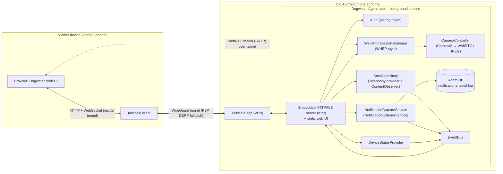

# Dogwatch — Design (v1)

Dogwatch turns an old Android phone left at home into a small, private, remotely
reachable device. From a browser on your laptop or main phone you can:

1. **Watch a live stream** from the phone's camera (with optional audio).
2. **Read SMS** received by the phone's SIM.
3. **Read push notifications** shown on the phone.

The camera is the main feature. SMS and notifications come almost for free once
the agent app and its API exist.

---

## 1. Assumptions and constraints

| # | Assumption | Why it matters |
|---|------------|----------------|
| A1 | The home phone runs **Android 7.0+ (API 24+)** | iOS doesn't let third-party apps read SMS or other apps' notifications, so on iOS only the camera would be possible. |
| A2 | The phone stays **plugged in and on Wi‑Fi** | Android's Doze mode doesn't kick in while charging, which makes a 24/7 background service practical. |
| A3 | The app is **sideloaded** (APK via `adb` or a file), not published on Google Play | Play only allows `READ_SMS` for default SMS apps. Sideloading avoids that rule. |
| A4 | There is **one owner/viewer** (you, maybe a partner), not a multi-tenant product | This keeps auth simple, and no server needs to hold your data. |
| A5 | Viewers use a modern browser (Chrome, Safari or Firefox; desktop or mobile) | WebRTC playback, WebSocket. |

## 2. Goals and non-goals

**v1 goals**
- Low-latency live video (under 1 s) from the back or front camera, with optional audio.
- A read-only SMS inbox: conversation list, message history, and new messages appearing live.
- A read-only notification feed: history of notifications posted on the phone, plus live updates.
- A device health panel showing battery, temperature, Wi‑Fi signal, uptime and permission status.
- Works from anywhere, not just the home LAN, **without exposing the phone to the public internet**.
- Nothing to host or pay for in the cloud.

**Non-goals for v1** (some are listed under Future work)
- Sending SMS, replying to or dismissing notifications, calls.
- Recording, motion detection, alerts and push notifications to the viewer.
- A native viewer app. The web UI is mobile-friendly and that's enough for now.
- iOS as the home device.
- Multiple home phones per account.

## 3. Key decision: how the viewer reaches the phone

This decision shapes everything else.

| Option | How it works | Pros | Cons |
|--------|--------------|------|------|
| **A. Phone is the server, reachable over Tailscale** ✅ | The phone runs an HTTP server. The phone and the viewer devices join the same Tailscale tailnet (a free WireGuard mesh VPN). | No cloud backend to build or run. Traffic is end-to-end encrypted. Nothing is reachable from the public internet. Works behind CGNAT. Video goes peer-to-peer. | Every viewer device needs the Tailscale app. The phone does all the work. |
| B. Cloud relay | The phone keeps an outbound WebSocket to a server you host. Browsers talk to that server. Video uses WebRTC with signaling and TURN on the server. | Any browser works without a VPN. Push alerts are easy to add. | You must build, host, secure and pay for a server. Your SMS (including 2FA codes) passes through it. More moving parts. |
| C. Port forwarding + dynamic DNS | Expose the phone's port on your router. | No extra software. | Puts your SMS on the open internet. Often impossible behind CGNAT. Needs TLS certificates. **Rejected.** |
| D. Existing apps (IP Webcam, AirDroid, Pushbullet, …) | Off the shelf. | Zero effort. | Each covers only part of the list, or routes your data through a third-party cloud. |

**Decision: Option A.** The phone holds very sensitive data: SMS means 2FA codes,
and the camera points at your home. A design where the phone is never publicly
reachable and no third party sees the data is the safest *and* the least work.
The code keeps transport separate from features (see §4), so Option B can be
added later as an alternative way in without rewriting anything.

## 4. Architecture



### 4.1 Components

**On the home phone: the `agent-android` app (Kotlin)**

| Component | Responsibility | Android APIs |
|-----------|----------------|--------------|
| `AgentService` | A long-running **foreground service** with a persistent notification. Owns the lifecycle of everything else. Holds a partial wake lock and a high-performance Wi‑Fi lock. | `Service.startForeground` with types `camera\|microphone\|dataSync`, `WifiManager.WifiLock`, `PowerManager.WakeLock` |
| `HttpServer` | An embedded Ktor (CIO engine) server on port `8080`. Serves the bundled web UI from APK assets, the REST API and a WebSocket event stream. | Ktor server, `kotlinx.serialization` |
| `Auth` | Pairing token, session cookie, rate limiting and an audit log. See §7. | `EncryptedSharedPreferences` / Keystore |
| `CameraController` | The single owner of the camera. Opens it **on demand**, reference-counted by consumers (WebRTC viewers, snapshot, MJPEG). Closes it 10 s after the last consumer leaves. Switches lens, resolution and torch. | WebRTC `Camera2Capturer` → `VideoSource` |
| `WebRtcSessionManager` | One `PeerConnection` per viewer (2 at most), all sharing one `VideoTrack` and one `AudioTrack`. Signaling is a single HTTP POST (offer in, answer out), modeled on the WHEP standard. | `org.webrtc` (e.g. `io.getstream:stream-webrtc-android`), hardware H.264 encoder with VP8 fallback |
| `JpegSink` | A `VideoSink` that turns frames into JPEG for `/snapshot.jpg` and the MJPEG fallback stream. | `YuvImage.compressToJpeg` |
| `SmsRepository` | Reads conversations and messages from the system SMS provider, resolves contact names, and watches for changes so new messages are pushed live. | `Telephony.Sms`, `ContentObserver`, `ContactsContract.PhoneLookup` |
| `NotificationCaptureService` | Receives every notification as it is posted or removed. Normalizes it and stores it, because Android keeps no notification history. | `NotificationListenerService` |
| `NotificationStore` | A Room/SQLite table of captured notifications with a retention policy. | Room |
| `DeviceStatusProvider` | Battery level and temperature, charging state, Wi‑Fi RSSI, free storage, uptime, permission and service health. | `BatteryManager`, `WifiManager` |
| `EventBus` | An in-process `SharedFlow` that fans events out to WebSocket clients. | Kotlin coroutines |
| `SetupActivity` | First-run wizard: grant permissions, show the pairing QR code, link to Tailscale. Also a status screen. | Activity Result APIs |

**On the viewer: the `web` single-page app**

- A static single-page app (TypeScript + Preact + Vite, about 100 KB) built into the APK's `assets/web/`.
  Because the phone serves it, the UI and API versions always match and there is nothing to deploy elsewhere.
- Views: **Live** (video player, lens switch, audio toggle, snapshot button) · **SMS**
  (conversation list → thread) · **Notifications** (feed with an app filter) · **Status**.
- One WebSocket (`/api/events`) delivers live updates to every view.
- The layout is mobile-first, with a web app manifest so it can be added to the home screen.

### 4.2 Repository layout

```
dogwatch/
├── agent-android/            # Android app that runs on the old phone
│   └── app/src/main/
│       ├── java/…/dogwatch/
│       │   ├── AgentService.kt
│       │   ├── server/       # Ktor routes, auth, WebSocket
│       │   ├── camera/       # CameraController, WebRtcSessionManager, JpegSink
│       │   ├── sms/          # SmsRepository, models
│       │   ├── notifications/# NotificationCaptureService, NotificationStore (Room)
│       │   ├── status/       # DeviceStatusProvider
│       │   └── ui/           # SetupActivity
│       └── assets/web/       # ← build output of /web (copied by Gradle task)
├── web/                      # Viewer SPA (Vite + TS + Preact)
├── docs/
│   └── DESIGN.md
└── README.md
```

## 5. Feature design

### 5.1 Live camera stream

**Primary path: WebRTC.**
- Under 500 ms of latency, hardware H.264 encoding (cool and battery-friendly), adaptive bitrate and audio.
- **Signaling is WHEP-style.** The browser creates an offer with `recvonly` video and audio and
  sends `POST /api/camera/whep` with the SDP. The agent waits for ICE gathering to finish
  (under 1 s on a LAN or tailnet) and returns the SDP answer. There's one request,
  no trickle ICE, and no separate signaling channel. `DELETE /api/camera/whep/{id}` ends the session.
- **ICE / NAT:** Inside a tailnet both peers can reach each other's `100.x.y.z` address directly,
  so no TURN server is needed. A public STUN server is still configured as a fallback.
  The agent must **not** filter out VPN adapters (`RTCConfiguration.networkIgnoreMask`) so that the
  Tailscale interface's candidates are offered. Browsers hide host candidates behind mDNS
  `.local` names, which won't resolve across the tailnet. That's fine: the phone learns the
  browser's address from incoming connectivity checks (peer-reflexive candidates).
- Default profile: 1280×720 at 24 fps, capped at 2 Mbps. The viewer can pick a "Low" profile
  (640×360 at 15 fps, 500 kbps) for mobile data.
- Audio: mic → Opus. On by default, with a mute toggle on the phone side. The agent setting is
  "allow audio", so the phone owner can turn it off entirely.

**Fallback and utility paths**
- `GET /api/camera/snapshot.jpg` returns one JPEG. It's useful for thumbnails, debugging and future alerts.
- `GET /api/camera/mjpeg` is a `multipart/x-mixed-replace` stream at 640×480 and about 10 fps.
  It plays in a plain `` tag, so it works where WebRTC fails, costs no setup, and is the first milestone.
  It uses more bandwidth (about 2–4 Mbps) and has no audio.

**Camera lifecycle**
- The camera is closed when nobody is watching. Each consumer (a WebRTC peer, MJPEG client
  or snapshot) takes a reference, and the camera closes 10 s after the count reaches zero.
  This keeps the phone cool, saves power and limits Android's green camera indicator to
  when you're actually watching.
- `POST /api/camera/settings {lens, profile, torch}` applies to the shared capturer,
  so every viewer sees the change.

### 5.2 SMS (read-only)

- **Permissions:** `READ_SMS`, plus optional `READ_CONTACTS` for showing names.
- **Reading:** Query `Telephony.Sms.CONTENT_URI` for `_id, thread_id, address, body, date, type,
  read, sub_id`. Conversations are grouped by `thread_id` in code, not through the
  `content://mms-sms/conversations` URI, which behaves differently from one phone maker to another.
- **Live updates:** Register a `ContentObserver` on `content://sms`. When it fires, read the rows
  newer than the last seen `_id` and emit `sms.received` or `sms.sent` events. This catches
  messages whichever app wrote them, and needs no `RECEIVE_SMS`.
- **Paging:** keyset pagination on `(date, _id)`.
- **Dual SIM:** `sub_id` maps to a SIM label (`SubscriptionManager`) shown in the UI.
- **Out of scope for v1:** MMS and RCS. Group MMS and pictures live in `content://mms` and need
  extra parsing. Google Messages' RCS chats aren't in the SMS provider at all, though they still
  show up in the notification feed (§5.3).

### 5.3 Push notifications (read-only)

This is **not complex**: about 200 lines of code, so it's in v1.

- `NotificationCaptureService extends NotificationListenerService`. The user enables it once under
  *Settings → Notifications → Notification access*. The setup wizard deep-links there.
- `onNotificationPosted(sbn)` extracts:
  `package`, app label, `EXTRA_TITLE`, `EXTRA_TEXT`, `EXTRA_BIG_TEXT`, `EXTRA_SUB_TEXT`,
  `EXTRA_MESSAGES` (MessagingStyle: chat apps put the last few messages here), `category`,
  `postTime`, `key`, `groupKey`, `isOngoing`.
- **Noise filtering:** drop ongoing and foreground-service notifications (media players, our own
  service), group summaries, and exact duplicates. Apps re-post the same `key` on every update,
  so the store upserts by `key` when the content is unchanged and inserts a new row when the text changes.
- `onNotificationRemoved` stamps `removedAt` so the UI can show dismissed or active status.
- On startup, `getActiveNotifications()` fills in what is currently on screen.
- **Storage:** Room table `notification(id, key, pkg, appLabel, title, text, bigText, subText,
  messagesJson, category, postedAt, removedAt)`. Retention: 30 days or 20 000 rows, whichever comes first.
- App icons are served from `GET /api/apps/{pkg}/icon.png` (rendered from `PackageManager`, cached).
- **Known limitation:** Android 15+ redacts one-time-password notifications for listener
  apps that aren't trusted. The full OTP text is still readable through the SMS feature.

### 5.4 Device status

`GET /api/status` (also pushed every 30 s over the WebSocket):
```json
{
  "battery": {"level": 100, "charging": true, "tempC": 31.5},
  "wifi": {"ssid": "home", "rssi": -52},
  "storageFreeMb": 5120,
  "uptimeSec": 864000,
  "camera": {"state": "idle", "viewers": 0},
  "permissions": {"camera": true, "mic": true, "sms": true, "notifications": true, "batteryOptExempt": true},
  "agentVersion": "0.1.0"
}
```
The UI shows a warning banner when something is degraded, for example when notification access was revoked or the battery is hot.

## 6. API (v1)

All endpoints are under `/api` and require auth (§7).

| Method | Path | Description |
|--------|------|-------------|
| `POST` | `/api/auth/pair` | Exchange the pairing token for a session cookie |
| `GET`  | `/api/status` | Device health |
| `GET`  | `/api/events` (WebSocket) | Live events: `sms.received`, `sms.sent`, `notification.posted`, `notification.removed`, `status`, `camera.state` |
| `POST` | `/api/camera/whep` | SDP offer → SDP answer (`201`, `Location: /api/camera/whep/{id}`) |
| `DELETE` | `/api/camera/whep/{id}` | Close a WebRTC session |
| `GET`  | `/api/camera/snapshot.jpg` | Single frame |
| `GET`  | `/api/camera/mjpeg` | MJPEG fallback stream |
| `POST` | `/api/camera/settings` | `{lens: "back"\|"front", profile: "hd"\|"low", torch: bool}` |
| `GET`  | `/api/sms/threads?limit=&before=` | Conversation list (last message, unread count, contact name) |
| `GET`  | `/api/sms/threads/{threadId}/messages?limit=&before=` | Messages in a thread |
| `GET`  | `/api/notifications?limit=&before=&pkg=` | Notification history |
| `GET`  | `/api/notifications/active` | Currently shown notifications |
| `GET`  | `/api/apps/{pkg}/icon.png` | App icon |

Event envelope over the WebSocket: `{"type": "sms.received", "ts": 1730000000000, "data": {…}}`.

## 7. Security and privacy

This toolkit gives remote access to your **SMS (including bank and 2FA codes)** and a
**camera inside your home**. Security works in layers:

1. **Network:** The phone is reachable only through the tailnet. The server binds to the
   Tailscale interface by default, with an opt-in setting to also listen on the LAN.
   Tailscale ACLs can restrict which of your devices may reach the phone's port 8080.
   No port forwarding and no public endpoint.
2. **Transport:** WireGuard encrypts everything between devices. The web UI runs over plain HTTP
   *inside* the tunnel, so no certificates are needed. WebRTC media is additionally encrypted (DTLS-SRTP).
3. **App auth:**
   - On first run the agent generates a 256-bit random **pairing token**, stored with Keystore-backed encryption.
   - The setup screen shows a QR code with `http://<phone-tailnet-name>:8080/#pair=<token>`.
     Scanning it with the viewer device opens the UI, which exchanges the token for an
     `HttpOnly`, `SameSite=Strict` session cookie.
   - Sessions can be listed and revoked from the phone. A "Rotate token" button logs out every viewer.
   - Failed auth attempts are rate-limited, with lockout and backoff.
   - Origin/Host header check on WebSocket and state-changing requests, against cross-site requests and DNS rebinding.
4. **Read-only by design:** v1 can't send SMS or act on notifications. If the phone is compromised, the worst case is reading, not acting.
5. **Audit log:** Each request is logged (time, viewer session, endpoint), and the phone keeps the
   last 7 days. Starting a camera session also raises a local notification on the phone.
6. **Visible indicators:** Android's camera and mic privacy dots, plus the persistent
   foreground-service notification, make it obvious when streaming is active.

## 8. Reliability on an old phone

| Risk | Mitigation |
|------|------------|
| The OS kills the background service | Foreground service with `START_STICKY`. Ask for a battery-optimization exemption. The setup wizard links to [dontkillmyapp.com](https://dontkillmyapp.com) steps for the phone's maker (Xiaomi, Huawei, Samsung…). |
| Agent not running after a reboot | A `BOOT_COMPLETED` receiver restarts `AgentService`. |
| **Camera blocked after a background start** (Android 11+ "while-in-use" rule: a foreground service started from the background can't open the camera or mic) | ⚠️ **Spike in M0.** Options to test: (a) is a boot-time start exempt on the target device? (b) hold `SYSTEM_ALERT_WINDOW` and briefly show a transparent activity on boot; (c) worst case, the status page shows "camera needs one tap on the phone after reboot". Reboots are rare for a phone that's always plugged in. |
| Wi‑Fi sleeps or gets slow | `WifiLock` in low-latency or high-performance mode. A watchdog checks connectivity and that Tailscale is up, and shows the result in status. |
| Tailscale VPN gets disconnected | Tailscale's "Always-on VPN" (Android Settings → VPN). The agent detects the VPN interface and reports it. |
| Overheating while streaming | The camera is on only while someone watches. If the battery is above 42 °C, drop to the Low profile. Above 45 °C, stop the stream and report why. |
| **Battery swelling from 24/7 charging** | Recommend the phone's built-in charge limit (80 %) if it has one, or a smart plug cycling between about 40 and 80 %. Show the battery temperature in the UI. |
| Memory leaks over weeks of uptime | One capturer shared by all viewers. Hard cap of 2 WebRTC peers. Peers are closed when their `DELETE` is missing (ICE disconnected for more than 15 s). |

## 9. Setup flow (user-facing)

1. On the old phone, install Tailscale and sign in. Enable *Always-on VPN*.
2. Install the Dogwatch APK, for example `adb install dogwatch.apk`.
   On Android 13+, if you install from a file manager or browser instead, you may need to open
   *App info → ⋮ → Allow restricted settings* before Android lets you grant notification access.
3. Open Dogwatch. The wizard asks for Camera, Microphone, SMS, Contacts (optional),
   Notification access and the battery-optimization exemption.
4. On your laptop or phone: install Tailscale, sign in with the same account, then scan the
   QR code shown by Dogwatch. Done.

## 10. Tech stack summary

| Area | Choice | Why |
|------|--------|-----|
| Agent language | Kotlin, coroutines | Standard for Android |
| Embedded server | Ktor (CIO engine) | Runs on Android, has WebSockets, coroutine-native. (NanoHTTPD is simpler but its WebSocket support is weaker.) |
| WebRTC | `io.getstream:stream-webrtc-android` (maintained build of Google's libwebrtc) | Hardware encoders, `Camera2Capturer` |
| Storage | Room (SQLite) | Notification history, audit log |
| Viewer UI | TypeScript + Preact + Vite | Small bundle, fast to build, ships inside the APK |
| Connectivity | Tailscale | Mesh VPN, free personal plan, no server to run |
| Build | Gradle; a Gradle task runs `npm run build` in `web/` and copies the output to assets | One artifact to install |
| `minSdk` / `targetSdk` | 24 / latest | Covers most phones from 2016 on |

## 11. Milestones

| # | Milestone | Done when |
|---|-----------|-----------|
| **M0** | Skeleton: `AgentService`, Ktor, pairing auth, `/api/status`, web shell, setup wizard. **Spike** on the camera-after-reboot behavior (§8). | Status page loads on a laptop over Tailscale after pairing by QR |
| **M1** | Camera v0: `CameraController`, snapshot, MJPEG | Live picture of the dog in the browser |
| **M2** | SMS: threads, messages, live updates | A new SMS appears in the browser within 2 s |
| **M3** | Notifications: listener, store, feed, icons | A WhatsApp or Telegram message shows up in the feed |
| **M4** | Camera v1: WebRTC (WHEP), audio, profiles, lens switch | Under 1 s latency over mobile data, audio works |
| **M5** | Hardening: boot restart, watchdog, thermal throttling, audit log, session revoke | 7 days of unattended uptime with no manual action |

## 12. Future work (v2+)

- **Alerts:** motion or bark detection (frame differencing, or on-device ML Kit / TFLite audio
  classification), pushed to you through a self-hosted ntfy server or a Telegram bot, with a snapshot.
- **Recording:** short clips around motion events, saved on the phone and browsable in the UI.
- **Two-way audio:** talk to the dog (`sendrecv` audio over the same WebRTC session).
- **Write actions:** send SMS replies, dismiss notifications, use notification reply actions (needs stronger auth, for example TOTP step-up).
- **Option B transport:** an optional cloud relay for viewers who can't install Tailscale.
- **Native viewer app** with real push notifications, if the web app isn't enough.
- MMS support, and multiple home devices.

## 13. Open questions for you

1. Which phone and Android version is the home device? This determines the reboot/camera spike, `minSdk` and any manufacturer-specific battery-killer workarounds.
2. Are you OK with Tailscale (or a similar mesh VPN such as ZeroTier or Headscale) on the viewer devices? If not, we revisit Option B.
3. Do you want audio in the stream on by default?
4. Does the phone have an active SIM? If not, the SMS feature can be dropped from v1.
